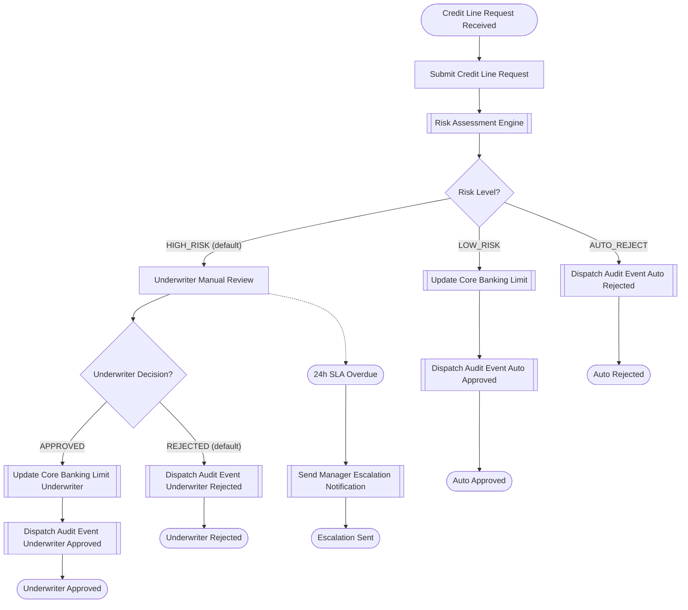

# Credit Line Increase Request

Handles customer requests for credit limit increases. Low-risk requests are auto-approved via Core Banking REST API; high-risk requests are escalated to the Underwriter team with 24-hour SLA monitoring and boundary timer escalation. All outcomes are captured in a full audit log.

Generated by the generate-baw-bpmn skill. Import **`CreditLineIncreaseRequest.zip`** into IBM BAW (Workflow Center > Import Process App, or Process Designer > File > Import).

## Process diagram

## Roles

| Role | Type | Steps |
|---|---|---|
| Process Initiator (CSR or Self-Service Portal) | Human | Submit Credit Line Request |
| System | System | Risk Assessment Engine, Update Core Banking Limit, Dispatch Audit Event Auto Approved, Dispatch Audit Event Auto Rejected, Update Core Banking Limit Underwriter, Dispatch Audit Event Underwriter Approved, Dispatch Audit Event Underwriter Rejected |
| Underwriter Team | Team | Underwriter Manual Review |
| Manager | Human | Send Manager Escalation Notification |

> Assign teams to each human step in Process Designer after import.

## Steps

| Step | Type | Performed by | Notes |
|---|---|---|---|
| Submit Credit Line Request | Human step | Process Initiator (CSR or Self-Service Portal) | Client-Side Human Service (CSHS) coach. Coach template: clir-submit-request-coach.html (included in this ZIP). Captures: customerID, fullName, annualIncome, currentLimit, requestedIncrease, creditScore, channel. Validation rules enforced: requestedIncrease > 0, currentLimit >= 0, creditScore between 300-850, annualIncome > 0. Output bound to tw.local.customerInfo (type: CustomerInfo). Live risk preview computes all three PDD risk rules client-side before submission. Replace submitToBAW() stub with tw.local.customerInfo.* assignments and tw.coach.finish() after import. |
| Risk Assessment Engine | Automated (service flow) | System | Evaluates credit risk using three rules: (1) if creditScore < 650 -> status=REJECTED, riskLevel=AUTO_REJECT; (2) if currentLimit > annualIncome * 0.50 -> riskLevel=HIGH_RISK; (3) if requestedIncrease > (annualIncome + currentLimit) * 0.30 -> riskLevel=HIGH_RISK. Default: riskLevel=LOW_RISK, autoApproved=true. Writes to tw.local.riskAssessment. Reads from tw.local.customerInfo. |
| Update Core Banking Limit | Automated (service flow) | System | External REST integration: POST https://api.bank.internal/v1/limits/update. Payload: {customerId, requestedLimit, approvalStatus, processInstanceId}. Maps HTTP 200 txStatus -> tw.local.approvalDecision.status. Used on LOW_RISK auto-approval path. |
| Dispatch Audit Event Auto Approved | Automated (service flow) | System | Server Script service flow. Formats JSON audit log: {timestamp, processInstanceId, customerId, finalDecision: APPROVED, riskLevel: LOW_RISK}. Outputs to system log or HTTP audit endpoint. |
| Dispatch Audit Event Auto Rejected | Automated (service flow) | System | Server Script service flow. Formats JSON audit log: {timestamp, processInstanceId, customerId, finalDecision: REJECTED, riskLevel: AUTO_REJECT, reason: riskAssessment.riskReason}. Outputs to system log or HTTP audit endpoint. |
| Underwriter Manual Review | Human step | Underwriter Team | CSHS Coach assigned to Underwriter_Group team. Coach template: clir-underwriter-review-coach.html (included in this ZIP). Inputs (read-only display): tw.local.customerInfo and tw.local.riskAssessment. Captures outputs: approvalDecision.status (APPROVED or REJECTED), approvedAmount, approverComments. SLA: 24 hours — live countdown displayed in coach; coach shows SLA breach state automatically. Non-interrupting timer boundary fires at 24h to send manager escalation without terminating the task. Replace submitDecisionToBAW() stub with tw.local.approvalDecision.* assignments and tw.coach.finish() after import. Set processedBy = tw.system.user.name. |
| Send Manager Escalation Notification | Automated (service flow) | Manager | Sends escalation email to manager group when the 24h SLA is breached. Includes processInstanceId, customerId, elapsed time, and current task assignee. Does not terminate the underwriter review task. |
| Update Core Banking Limit Underwriter | Automated (service flow) | System | External REST integration: POST https://api.bank.internal/v1/limits/update. Payload: {customerId, approvedAmount, approvalStatus, processInstanceId}. Maps HTTP 200 txStatus -> tw.local.approvalDecision.status. Used on underwriter-approved path. |
| Dispatch Audit Event Underwriter Approved | Automated (service flow) | System | Server Script service flow. Formats JSON audit log: {timestamp, processInstanceId, customerId, finalDecision: APPROVED, riskLevel: HIGH_RISK, approver: approvalDecision.processedBy, approvedAmount}. Outputs to system log or HTTP audit endpoint. |
| Dispatch Audit Event Underwriter Rejected | Automated (service flow) | System | Server Script service flow. Formats JSON audit log: {timestamp, processInstanceId, customerId, finalDecision: REJECTED, riskLevel: HIGH_RISK, approver: approvalDecision.processedBy, reason: approvalDecision.approverComments}. Outputs to system log or HTTP audit endpoint. |

## Decision logic

- **Risk Level?** (exclusiveGateway):
  - LOW_RISK -> Update Core Banking Limit — `tw.local.riskAssessment.riskLevel == "LOW_RISK"`
  - AUTO_REJECT -> Dispatch Audit Event Auto Rejected — `tw.local.riskAssessment.riskLevel == "AUTO_REJECT"`
  - HIGH_RISK -> Underwriter Manual Review *(default path)*
- **Underwriter Decision?** (exclusiveGateway):
  - APPROVED -> Update Core Banking Limit Underwriter — `tw.local.approvalDecision.status == "APPROVED"`
  - REJECTED -> Dispatch Audit Event Underwriter Rejected *(default path)*

Conditions are starting points; finalize them in Process Designer after import.

## Service flows BAW generates on import

- **Risk Assessment Engine** — Evaluates credit risk using three rules: (1) if creditScore < 650 -> status=REJECTED, riskLevel=AUTO_REJECT; (2) if currentLimit > annualIncome * 0.50 -> riskLevel=HIGH_RISK; (3) if requestedIncrease > (annualIncome + currentLimit) * 0.30 -> riskLevel=HIGH_RISK. Default: riskLevel=LOW_RISK, autoApproved=true. Writes to tw.local.riskAssessment. Reads from tw.local.customerInfo.
- **Update Core Banking Limit** — External REST integration: POST https://api.bank.internal/v1/limits/update. Payload: {customerId, requestedLimit, approvalStatus, processInstanceId}. Maps HTTP 200 txStatus -> tw.local.approvalDecision.status. Used on LOW_RISK auto-approval path.
- **Dispatch Audit Event Auto Approved** — Server Script service flow. Formats JSON audit log: {timestamp, processInstanceId, customerId, finalDecision: APPROVED, riskLevel: LOW_RISK}. Outputs to system log or HTTP audit endpoint.
- **Dispatch Audit Event Auto Rejected** — Server Script service flow. Formats JSON audit log: {timestamp, processInstanceId, customerId, finalDecision: REJECTED, riskLevel: AUTO_REJECT, reason: riskAssessment.riskReason}. Outputs to system log or HTTP audit endpoint.
- **Send Manager Escalation Notification** — Sends escalation email to manager group when the 24h SLA is breached. Includes processInstanceId, customerId, elapsed time, and current task assignee. Does not terminate the underwriter review task.
- **Update Core Banking Limit Underwriter** — External REST integration: POST https://api.bank.internal/v1/limits/update. Payload: {customerId, approvedAmount, approvalStatus, processInstanceId}. Maps HTTP 200 txStatus -> tw.local.approvalDecision.status. Used on underwriter-approved path.
- **Dispatch Audit Event Underwriter Approved** — Server Script service flow. Formats JSON audit log: {timestamp, processInstanceId, customerId, finalDecision: APPROVED, riskLevel: HIGH_RISK, approver: approvalDecision.processedBy, approvedAmount}. Outputs to system log or HTTP audit endpoint.
- **Dispatch Audit Event Underwriter Rejected** — Server Script service flow. Formats JSON audit log: {timestamp, processInstanceId, customerId, finalDecision: REJECTED, riskLevel: HIGH_RISK, approver: approvalDecision.processedBy, reason: approvalDecision.approverComments}. Outputs to system log or HTTP audit endpoint.

## Exception and escalation paths

- **24h SLA Overdue** — timer event on *Underwriter Manual Review* (non-interrupting). Non-interrupting timer boundary event. Fires after 24 hours if the underwriter has not completed their review. Triggers manager escalation notification without cancelling the underwriter task.

## Data

| Variable | Type | Produced by | Used by |
|---|---|---|---|
| customerInfo | CustomerInfo | Submit Credit Line Request | Risk Assessment Engine, Update Core Banking Limit, Update Core Banking Limit Underwriter, Underwriter Manual Review, Dispatch Audit Event Auto Approved, Dispatch Audit Event Auto Rejected, Dispatch Audit Event Underwriter Approved, Dispatch Audit Event Underwriter Rejected, Send Manager Escalation Notification |
| riskAssessment | RiskAssessment | Risk Assessment Engine | Risk Level?, Underwriter Manual Review, Dispatch Audit Event Auto Approved, Dispatch Audit Event Auto Rejected, Dispatch Audit Event Underwriter Approved, Dispatch Audit Event Underwriter Rejected |
| approvalDecision | ApprovalDecision | Underwriter Manual Review, Update Core Banking Limit, Update Core Banking Limit Underwriter | Underwriter Decision?, Dispatch Audit Event Underwriter Approved, Dispatch Audit Event Underwriter Rejected, Dispatch Audit Event Auto Approved |

Business objects (defined in `CreditLineIncreaseRequest.xsd`, imported as BAW business objects):

- **CustomerInfo** — Captures all customer data submitted in the credit line increase request form. Used by risk engine, banking integration, and audit steps. (customerID: String, fullName: String, creditScore: Integer, annualIncome: Decimal, currentLimit: Decimal, requestedIncrease: Decimal, submissionDate: DateTime, channel: String)
- **RiskAssessment** — Output of the Risk Assessment Engine. riskLevel values: LOW_RISK, HIGH_RISK, AUTO_REJECT. autoApproved is true only when riskLevel=LOW_RISK. (riskLevel: String, riskReason: String, autoApproved: Boolean, assessedDate: DateTime, engineVersion: String)
- **ApprovalDecision** — Final credit line decision. status values: APPROVED, REJECTED, PENDING_UNDERWRITER. processedBy is the underwriter user ID or 'SYSTEM' for automated decisions. (status: String, approvedAmount: Decimal, approverComments: String, processedBy: String, decisionTimestamp: DateTime, bankingTxId: String)

## Files

- `CreditLineIncreaseRequest.bpmn` — BPMN 2.0 XML in BAW's export dialect.
- `CreditLineIncreaseRequest.xsd` — business object schema (must stay in the zip).
- `CreditLineIncreaseRequest.zip` — the archive to import.

## After importing

1. Complete each generated service flow's implementation.
2. Finalize gateway conditions against real variables.
3. Customize the generated coaches for human steps and assign teams.
4. Set timer durations on any timer events, initialize variables, adjust layout, and run BAW validation.
