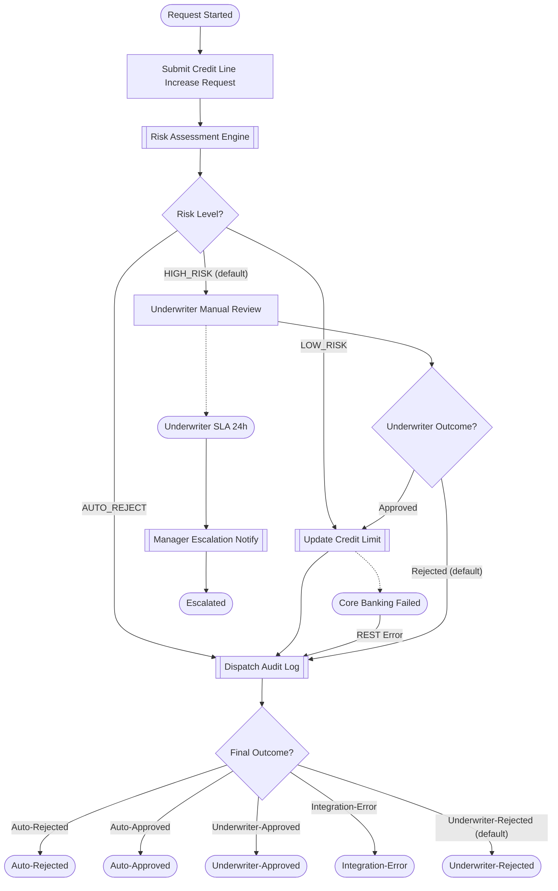

# Credit Line Increase Request

Automated credit line increase: customer/agent submits via Coach View 'CLIR Customer Info Form', system risk rules auto-approve or auto-reject, high-risk cases go to underwriter review via Coach View 'CLIR Underwriter Review Form' with a 24-hour SLA escalation, Core Banking REST updates the limit, and an audit event is dispatched.

Generated by the generate-baw-bpmn skill. Import **`CreditLineIncreaseRequest.zip`** into IBM BAW (Workflow Center > Import Process App, or Process Designer > File > Import).

## Process diagram

## Roles

| Role | Type | Steps |
|---|---|---|
| Customer / Agent | Human | Submit Credit Line Increase Request |
| Underwriter Team | Team | Underwriter Manual Review |
| System | System | Risk Assessment Engine, Update Credit Limit, Manager Escalation Notify, Dispatch Audit Log |

> Assign teams to each human step in Process Designer after import.

## Steps

| Step | Type | Performed by | Notes |
|---|---|---|---|
| Submit Credit Line Increase Request | Human step | Customer / Agent | CSHS uses Coach View component 'CLIR Customer Info Form' (business-processes/coaches/coach-views/CLIR_CustomerInfoForm). Bind the Coach View to tw.local.customerInfo. Fields: customerID, fullName, creditScore, annualIncome, currentLimit, requestedIncrease. Client validate: annualIncome > 0; requestedIncrease > currentLimit; creditScore 300-850. On success sets customerInfo.status = SUBMITTED. Source: content.html + styles.css + handlers/load|view|change|validate.js. |
| Risk Assessment Engine | Automated (service flow) | System | Server script / decision service flow. Rule 1: if creditScore < 650 -> riskLevel=AUTO_REJECT, autoApproved=false, riskReason='Credit score below minimum threshold', approvalDecision.status=REJECTED, processedBy='SYSTEM_RISK_ENGINE'. Rule 2: else if currentLimit > (annualIncome * 0.50) -> riskLevel=HIGH_RISK, autoApproved=false, riskReason='High exposure ratio', approvalDecision.status=PENDING_UNDERWRITER. Rule 3: else if requestedIncrease > (annualIncome + currentLimit) * 0.30 -> riskLevel=HIGH_RISK, autoApproved=false, riskReason='Requested increase exceeds 30% financial capacity', approvalDecision.status=PENDING_UNDERWRITER. Default: riskLevel=LOW_RISK, autoApproved=true, riskReason='Passed automated risk checks', approvalDecision.status=APPROVED, approvedAmount=requestedIncrease, processedBy='SYSTEM_RISK_ENGINE'. |
| Update Credit Limit | Automated (service flow) | System | External Service (OpenAPI). POST https://api.bank.internal/v1/limits/update. Request: { accountHolderId: tw.local.customerInfo.customerID, newCreditLimit: tw.local.approvalDecision.approvedAmount || tw.local.customerInfo.requestedIncrease, approvalSource: tw.local.riskAssessment.autoApproved ? 'BAW_AUTO_APPROVAL' : 'BAW_UNDERWRITER_APPROVAL' }. Map HTTP 200 txStatus into tw.local.approvalDecision.status. Assumption: underwriter Approved also calls this REST (PDD ASCII only showed Core Banking on LOW_RISK path). |
| Underwriter Manual Review | Human step | Underwriter Team | CSHS uses Coach View component 'CLIR Underwriter Review Form' (business-processes/coaches/coach-views/CLIR_UnderwriterReviewForm). Bind Coach View to tw.local.approvalDecision; config-bind customerInfo -> tw.local.customerInfo and riskAssessment -> tw.local.riskAssessment (read-only). Capture status APPROVED/REJECTED, approvedAmount, approverComments, processedBy. Assign to team Underwriter_Group. SLA: 24-hour non-interrupting timer boundary. Source: content.html + styles.css + handlers/load|view|change|validate.js. |
| Manager Escalation Notify | Automated (service flow) | System | Sends manager escalation notification email for overdue underwriter review. Sets approvalDecision.status = ESCALATED (extended beyond PDD enum for routing) and customerInfo.status = ESCALATED. |
| Dispatch Audit Log | Automated (service flow) | System | Formats JSON audit payload with system timestamp, process instance ID, customerID, riskLevel, and final approvalDecision. Writes to system log and/or HTTP audit endpoint. |

## Decision logic

- **Risk Level?** (exclusiveGateway):
  - AUTO_REJECT -> Dispatch Audit Log — `tw.local.riskAssessment.riskLevel == "AUTO_REJECT"`
  - LOW_RISK -> Update Credit Limit — `tw.local.riskAssessment.riskLevel == "LOW_RISK"`
  - HIGH_RISK -> Underwriter Manual Review *(default path)*
- **Underwriter Outcome?** (exclusiveGateway):
  - Approved -> Update Credit Limit — `tw.local.approvalDecision.status == "APPROVED"`
  - Rejected -> Dispatch Audit Log *(default path)*
- **Final Outcome?** (exclusiveGateway):
  - Auto-Rejected -> Auto-Rejected — `tw.local.riskAssessment.riskLevel == "AUTO_REJECT"`
  - Auto-Approved -> Auto-Approved — `tw.local.riskAssessment.riskLevel == "LOW_RISK" && tw.local.approvalDecision.status == "APPROVED"`
  - Underwriter-Approved -> Underwriter-Approved — `tw.local.riskAssessment.riskLevel == "HIGH_RISK" && tw.local.approvalDecision.status == "APPROVED"`
  - Integration-Error -> Integration-Error — `tw.local.approvalDecision.status == "INTEGRATION_ERROR"`
  - Underwriter-Rejected -> Underwriter-Rejected *(default path)*

Conditions are starting points; finalize them in Process Designer after import.

## Service flows BAW generates on import

- **Risk Assessment Engine** — Server script / decision service flow. Rule 1: if creditScore < 650 -> riskLevel=AUTO_REJECT, autoApproved=false, riskReason='Credit score below minimum threshold', approvalDecision.status=REJECTED, processedBy='SYSTEM_RISK_ENGINE'. Rule 2: else if currentLimit > (annualIncome * 0.50) -> riskLevel=HIGH_RISK, autoApproved=false, riskReason='High exposure ratio', approvalDecision.status=PENDING_UNDERWRITER. Rule 3: else if requestedIncrease > (annualIncome + currentLimit) * 0.30 -> riskLevel=HIGH_RISK, autoApproved=false, riskReason='Requested increase exceeds 30% financial capacity', approvalDecision.status=PENDING_UNDERWRITER. Default: riskLevel=LOW_RISK, autoApproved=true, riskReason='Passed automated risk checks', approvalDecision.status=APPROVED, approvedAmount=requestedIncrease, processedBy='SYSTEM_RISK_ENGINE'.
- **Update Credit Limit** — External Service (OpenAPI). POST https://api.bank.internal/v1/limits/update. Request: { accountHolderId: tw.local.customerInfo.customerID, newCreditLimit: tw.local.approvalDecision.approvedAmount || tw.local.customerInfo.requestedIncrease, approvalSource: tw.local.riskAssessment.autoApproved ? 'BAW_AUTO_APPROVAL' : 'BAW_UNDERWRITER_APPROVAL' }. Map HTTP 200 txStatus into tw.local.approvalDecision.status. Assumption: underwriter Approved also calls this REST (PDD ASCII only showed Core Banking on LOW_RISK path).
- **Manager Escalation Notify** — Sends manager escalation notification email for overdue underwriter review. Sets approvalDecision.status = ESCALATED (extended beyond PDD enum for routing) and customerInfo.status = ESCALATED.
- **Dispatch Audit Log** — Formats JSON audit payload with system timestamp, process instance ID, customerID, riskLevel, and final approvalDecision. Writes to system log and/or HTTP audit endpoint.

## Exception and escalation paths

- **Core Banking Failed** — error event on *Update Credit Limit* (interrupting). Error boundary on Core Banking REST. Route to audit with rejected/error outcome for recovery visibility.
- **Underwriter SLA 24h** — timer event on *Underwriter Manual Review* (non-interrupting). Non-interrupting timer. Duration: 24 hours (PT24H). On fire, trigger Manager Escalation Notification Email handler. Set timer duration in Process Designer after import.

## Data

| Variable | Type | Produced by | Used by |
|---|---|---|---|
| customerInfo | CustomerInfo | Submit Credit Line Increase Request | Risk Assessment Engine, Update Credit Limit, Underwriter Manual Review, Manager Escalation Notify, Dispatch Audit Log |
| riskAssessment | RiskAssessment | Risk Assessment Engine | Update Credit Limit, Underwriter Manual Review, Manager Escalation Notify, Dispatch Audit Log |
| approvalDecision | ApprovalDecision | Risk Assessment Engine, Underwriter Manual Review, Update Credit Limit, Manager Escalation Notify | Update Credit Limit, Underwriter Manual Review, Manager Escalation Notify, Dispatch Audit Log |

Business objects (defined in `CreditLineIncreaseRequest.xsd`, imported as BAW business objects):

- **CustomerInfo** — Account-holder credit line request data. status values: SUBMITTED, IN_REVIEW, COMPLETED, ESCALATED. Validation: requestedIncrease > currentLimit; annualIncome > 0. creditScore range 300-850. (customerID: String, fullName: String, creditScore: Integer, annualIncome: Decimal, currentLimit: Decimal, requestedIncrease: Decimal, status: String)
- **RiskAssessment** — Automated risk engine output. riskLevel values: LOW_RISK, HIGH_RISK, AUTO_REJECT. status values: COMPLETE, ERROR. (riskLevel: String, autoApproved: Boolean, riskReason: String, assessedDate: DateTime, status: String)
- **ApprovalDecision** — Decision record. status values: APPROVED, REJECTED, PENDING_UNDERWRITER, ESCALATED, INTEGRATION_ERROR. processedBy is user id or system service account. (status: String, approvedAmount: Decimal, approverComments: String, processedBy: String, processedDate: DateTime)

## Files

- `CreditLineIncreaseRequest.bpmn` — BPMN 2.0 XML in BAW's export dialect.
- `CreditLineIncreaseRequest.xsd` — business object schema (must stay in the zip).
- `CreditLineIncreaseRequest.zip` — the archive to import.

## Coach Views included with this workflow

| Human task | Coach View component | Binding |
|---|---|---|
| Submit Credit Line Increase Request | **CLIR Customer Info Form** | `tw.local.customerInfo` |
| Underwriter Manual Review | **CLIR Underwriter Review Form** | `tw.local.approvalDecision` (+ customer/risk config) |

Source UI: `business-processes/coaches/coach-views/`  
Unified package: `business-processes/packages/CLIR-v1.1-with-coaches/` (see `INSTALL.md`)

## After importing

1. Create the two Coach Views from `coaches/coach-views/` (HTML/CSS/handlers) and drop them onto the generated CSHS coaches — see package `INSTALL.md`.
2. Complete each generated service flow's implementation (`scripts/RiskAssessmentEngine.js`, `DispatchAuditLog.js`, Core Banking OpenAPI).
3. Finalize gateway conditions against real variables.
4. Assign **Underwriter_Group**, set the 24h timer (`PT24H`), adjust layout, and run BAW validation.
